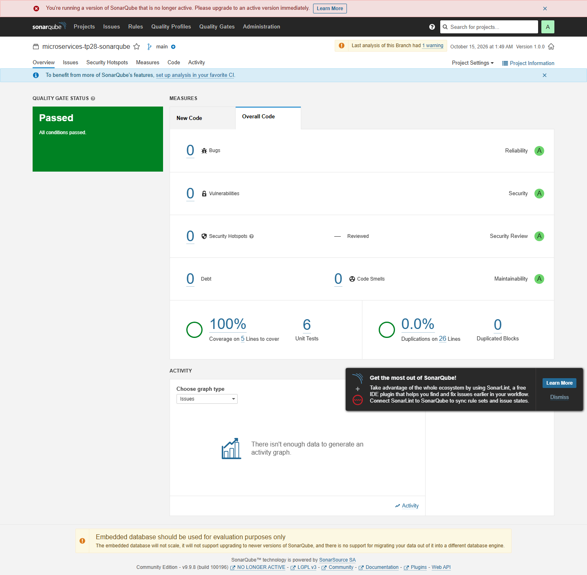

# TP28 — Analyse SonarQube

 J'ai utilisé un petit projet Java de gestion des notes pour vérifier le Quality Gate, les issues et la couverture JaCoCo. Les tests couvrent les notes invalides, la moyenne d'une liste vide et la sélection des étudiants admis. SonarQube garde ses données dans des volumes Docker.

 ```sh
 docker compose up -d
 mvn clean verify
 mvn sonar:sonar -Dsonar.projectKey=course7-tp28 -Dsonar.host.url=http://localhost:19928
 ```

 Ouvrir `http://localhost:19928`, créer le projet puis définir `SONAR_TOKEN` dans l'environnement avant l'analyse. Le token reste local. Je consulte d'abord les bugs et la sécurité, puis la maintenabilité, la couverture et les duplications. Le résultat réel du Quality Gate et les mesures sont conservés dans `evidence/`.

 Les traces d'exécution sont dans `evidence/` et les captures dans `screenshots/`.

 
